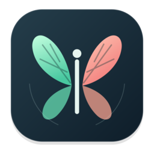

# Rekke · ರೆಕ್ಕೆ



**Rekke** takes its name from the [Kannada word for wing, ರೆಕ್ಕೆ](https://alar.ink/dictionary/kannada/english/%E0%B2%B0%E0%B3%86%E0%B2%95%E0%B3%8D%E0%B2%95%E0%B3%86).

A native Rust app for tracking the wings of a tethered insect, inspired by [Kinefly](https://github.com/ssafarik/Kinefly). It uses annular sectors, angular intensity profiles averaged over the radius, and edge detection. It runs independently of ROS and OpenCV.

Version 0.5.0 includes Kinefly Docker-compatible ZMQ PUB output, one-command multi-rig launch, automatic marker/config persistence, lossless video recording on a dedicated worker, and an optional broad-shoulder wing filter that removes thin bright pulses. It retains native USB/webcam capture, symmetric directly draggable annular sectors, body-frame transforms and saved-background subtraction in a compact Kinefly-style GUI. Head/abdomen tracking, signal plots, a synthetic camera and FFmpeg video/network inputs are also available. Mac releases use a single drag-installable app, a wing icon and a one-line app-specific quarantine workaround.

## Install

Download a build from [GitHub Releases](https://github.com/pvnkmrksk/rekke/releases/latest).

| Computer | Download | Installation |
| --- | --- | --- |
| Mac Apple Silicon | `Rekke-0.5.0-macos-arm64.dmg` | Drag Rekke.app into Applications |
| Mac Intel | `Rekke-0.5.0-macos-x64.dmg` | Drag Rekke.app into Applications |
| Ubuntu 22.04+ x86-64 | `rekke_0.5.0_amd64.deb` | `sudo apt install ./rekke_0.5.0_amd64.deb` |
| Windows 10/11 x64 | `Rekke-0.5.0-windows-x64-setup.exe` | Run the installer; installs for your user |

Portable ZIPs and a Linux tarball are available too. Run `rekke` (`rekke.exe` on Windows) from the extracted folder. No Python, ROS, OpenCV, FFmpeg or separate ZeroMQ runtime is needed for native webcam tracking. The optional live-plot helper needs Python/PyZMQ; video/network inputs use separately installed FFmpeg.

### Mac: normal drag-to-Applications installation

Open the DMG, drag **Rekke.app** onto the **Applications** shortcut, eject the image, and open Rekke from Applications. The app has its own wing icon and contains its resources; you only copy the app. Allow camera access when macOS asks.

Settings, markers and saved backgrounds live under `~/Library/Application Support/Rekke/configs/`, so the installed app never needs to modify its bundle. The first camera uses `camera-a.toml`; `camera-b.toml` and `rigs.toml` are seeded alongside it. The app shows the active config path in Settings. Existing config files are preserved; a previous `~/Library/Application Support/Wingtrace/wingtrace.toml` and its referenced baseline are imported on first launch if no Rekke state exists. Explicit `--config` paths remain independent.

This free release has an ad-hoc Mac signature, with no paid Apple Developer ID signature or notarization. A DMG does not remove Gatekeeper's publisher warning. For a release whose origin you trust, the one-time shortcut is:

```sh
xattr -dr com.apple.quarantine "/Applications/Rekke.app"
```

Then open the copied app normally. Change the path if you installed elsewhere. This clears quarantine only on that app; it does not turn off Gatekeeper globally or sign/notarize the app. Repeat for a new downloaded release if needed. The DMG's **Install help** includes the same instructions. [Apple's explanation](https://developer.apple.com/forums/thread/739357).

Alternatively, try opening once and use **System Settings → Privacy & Security → Open Anyway**. macOS 15 and later removed the older right-click override; macOS 14 and earlier can use Finder **right-click → Open**. [Apple instructions](https://support.apple.com/en-au/102445), [macOS 15 change](https://developer.apple.com/news/?id=saqachfa). An alert specifically reporting malware/damage is a different issue; check the release rather than treating it as the ordinary publisher warning.

### Windows and Ubuntu

The Windows installer adds Start-menu and desktop shortcuts, embeds the wing icon in the executable, and installs under `%LOCALAPPDATA%\Programs\Rekke`. User settings/backgrounds are in `%APPDATA%\Rekke\configs`. Uninstall removes program files and shortcuts while preserving user state. Windows builds are unsigned and may show SmartScreen; verify the release's origin before approving it.

The Ubuntu `.deb` installs `rekke` on PATH and adds a Science-menu launcher/icon. Runtime dependencies are installed by `apt`. User state is under `${XDG_CONFIG_HOME:-~/.config}/rekke/configs`. The x86-64 build targets Ubuntu 22.04's glibc and is intended for 22.04 and newer. Camera device access follows normal OS/driver permissions.

### Start a camera or several rigs

Launch the app to open the first available camera. Edit camera/marker settings in the GUI; changes save automatically. To run all configured rigs from an installed build:

```sh
rekke --rigs
rekke --rigs --headless --record
```

On Mac use `/Applications/Rekke.app/Contents/MacOS/rekke` for that command. Configure the seeded camera files and `rigs.toml` once; each rig has its own device, background and output port. Close a single instance before starting that same config through the rig launcher. Explicit paths also work:

```sh
rekke --config /path/to/camera-a.toml
rekke --rigs /path/to/rigs.toml
```

## Build from source

```sh
git clone https://github.com/pvnkmrksk/rekke.git
cd rekke
```


Install the current stable [Rust toolchain](https://rustup.rs/). Windows needs the MSVC C++ build tools and NASM (for example `choco install nasm`). macOS needs Xcode command-line tools; Intel macOS also needs NASM (`brew install nasm`). On Ubuntu 22.04 or newer:

```sh
sudo apt-get install build-essential pkg-config nasm libclang-dev libv4l-dev libx11-dev libxi-dev libxrandr-dev libxcursor-dev libxkbcommon-dev libxkbcommon-x11-0 libwayland-dev libegl1-mesa-dev
```

Then, from this repository:

```sh
cargo build --release --locked
cargo run --release --locked -- --config configs/demo.toml
```

`target/release/rekke` is the executable. Native webcam capture requires no FFmpeg, Python, ROS, OpenCV, or separate ZeroMQ runtime. The `camera` feature uses Nokhwa (AVFoundation on macOS, Media Foundation on Windows, V4L2 on Linux). A processing-only headless build is also available:

```sh
cargo build --release --locked --no-default-features
cargo build --release --locked --no-default-features --features camera
```

The GitHub release workflow builds and tests on native Ubuntu, Windows, Apple Silicon Mac and Intel Mac runners. Tagged releases publish the installers, portable packages and checksums only after every build passes. Ubuntu builds include an installed-executable/GUI smoke check; Windows builds verify the installer and embedded icon. These checks do not test physical cameras. Linux packages depend on system graphics libraries; they are not fully static binaries.

## Set up tracking

The camera fills the window. A compact toolbar holds **Save BG**, tracking toggles **H / A / L / R**, **Asymmetric**, **Subtract**, **Invert**, **Start / Stop**, **Record**, **Save**, and **Settings**. Left/right threshold controls are always within reach. Live angles appear unobtrusively in the lower-left corner, with FPS, recording and output status along the bottom.

1. Launch the app. Installed apps use the writable per-user config described above; portable CLI packages prefer local/adjacent configs. The default source is `device = "auto"`: the first camera returned by the OS. It tries the requested mode, then the closest supported native mode, resizing to configured coordinates when needed. Actual receive FPS is displayed. An explicitly selected index/path requires a supported exact mode.
2. Drag the magenta head anchor and cyan tail anchor onto the insect to define its body axis. Moving either endpoint keeps the other fixed, recomputes their midpoint, and translates/rotates all four tracking regions into the new body frame. Radii, angular spans, and relative offsets stay unchanged. Drag the white midpoint dot to translate the whole setup. These calibration points remain available when head/abdomen tracking is off.
3. Drag either red left or green right hinge dot onto its wing base. **Asymmetric is off by default:** the other wing mirrors the edit across the current head/tail axis, even after rotating the body. Both wings' handles are active at the same time: no region selection or edit mode is needed.
4. Drag either outer corner to change its angular limit **and outer radius in one gesture**. Drag the middle dot on the inner or outer arc to change only that radius. Wing angles, spans and radii mirror to the opposite wing. Small dots enlarge on hover. Settings offers precise numeric editing with the same symmetry rules. Configuration angles run clockwise from image-right; sectors crossing zero are supported.
5. Switch **L / R / H / A** off to remove that tracker's entire region, handles, measurement lines and readout. H/A regions start off; the body calibration anchors remain for wing measurements. Switching every tracker off hides all overlays. Disabled measurements are `null` in the output.
6. The default **Strongest edge** detector uses threshold **0**, selecting the largest measurable absolute angular gradient, including very faint signals. It reports no edge for a flat profile, a below-threshold signal or insufficient ROI coverage. A small numerical floor prevents floating-point artifacts; it is well below a one-level 8-bit contrast in the tested geometry. Raising the L/R thresholds takes effect while running. Noise and illumination gradients can win at zero threshold; the detector does not infer wing identity.
7. Marker geometry, body anchors, symmetry, detector settings and all other valid config edits are **automatically saved** after 300 ms idle, with the final pending edit flushed on normal close. Writes are atomic and performed by a separate worker. **Save** requests a write immediately through the same worker. Turn off `autosave` in Settings for manual saving. Tracking edits apply live; source, instance, output and background-path changes need **Settings → Restart acquisition**. Invalid edits show an error and leave the last valid file intact. Each explicit config is this instance's saved state; keep it writable and give each instance its own file.

Settings contains the detector, primary-edge rule, precise geometry, optional diagnostics, input source, output ports and sampling controls. Two or more `max_edges` allow both wing boundaries to be reported. **Strongest** is the default primary rule; toward-head and toward-tail selection remain available. The GUI and wire readouts both use radians.

Enable **Asymmetric** to move wing geometry and body anchors independently. Switching it off restores the other wing from the last wing you edited (Left until the first wing edit). The mode is saved as `tracking.asymmetric` in each instance's TOML; older configs without that field default to symmetric editing. Enabled flags and detector settings stay independent in either mode, and disabled regions retain their geometry so they are aligned when re-enabled. The body frame controls the overlay geometry; the camera image retains its orientation. Moves that collapse the body/wing axes or put an anchor outside the image are rejected; center translation stops at the image boundary without distorting the setup.

Head and abdomen can be enabled in the toolbar. Their default detector is an angular foreground centroid, not Kinefly's polar image registration or stabilization.

## Faint blur and moving obstructions

Enable **Reject spikes** beside the live thresholds to switch both wings, or choose **Settings → Detector → Wing blur · experimental** per wing (TOML `method = "wing_blur"`) first limits contrast, then removes short bright pulses from each angular intensity profile using a grayscale morphological opening. It keeps a broad low shoulder while suppressing thin bright antenna/leg pulses, including intrusions that cross most of the radial range. It then ranks the median signed derivative across up to eight radial bands, reducing short radial obstructions as well. There is no temporal locking to a last angle, so a genuine fast change remains visible. The default remains ordinary strongest-edge detection.

`spike_width_deg = 5.0` is the initial angular rejection width. Adjust **Reject pulses under** live to be wider than the nuisance pulses and narrower than the useful wing haze. Set it to `0.0` to use only radial consensus. `contrast_cap = 0.12` limits contrast above the local band baseline; the threshold still applies after filtering. Widths quantize to angular bins. With too few bins or a wing shoulder narrower than the filter, it can remove the wing too. Broad obstructions, overlapping features at the wing boundary, partial radial wing visibility and lighting/background motion can still confuse it. Features touching the sector boundary are less reliable.

Synthetic regressions cover one-level faint shoulders and much brighter narrow pulses inside, outside and near the wing, backgrounds, radial intrusions, flat scenes and a scene containing only pulses. **This is a spatial heuristic, not validated anatomical recognition.** Real insect recordings are still needed to tune and validate it. Stopped-flight classification and wingbeat-frequency estimation remain future work.

## Background subtraction

Capture an empty, still image with **Save BG**, then place the insect and enable **Subtract**. The app saves a grayscale PNG at `tracking.background_path` and computes absolute pixel differences against that reference. **Settings → Background → Load saved background** reuses it; restarting loads the last saved reference automatically. Saving replaces that PNG atomically; ordinary acquisition and exit never recapture or overwrite the baseline, so the animal cannot silently become part of your background. The reference must match the configured frame size. **Difference view** displays the foreground when subtraction is active.

For the simulated camera, **Settings → Background → Use clean demo background** saves the empty scene. Capturing a normal demo frame saves the insect too, just as a real camera would.

Missing or mismatched references produce an error. With subtraction off, the default analyzes a dark insect against a light image. **Invert** changes the analysis polarity for bright insects on dark backgrounds and inverts the preview. Camera movement and illumination changes require a fresh reference.

## Multiple rigs with one command

Edit each camera config once, mapping `source.device` to an OS camera index/path and assigning its own instance name, background path, UDP sender port and ZMQ publisher port. The included `configs/rigs.toml` lists the two camera configs. Add or disable `[[rigs]]` entries to set N:

```toml
[[rigs]]
config = "camera-a.toml"
enabled = true
record = false

[[rigs]]
config = "camera-b.toml"
enabled = true
record = false
```

From an extracted portable package, launch every enabled rig with:

```sh
./rekke --rigs configs/rigs.toml
```

On macOS the app's executable works too: `./Rekke.app/Contents/MacOS/rekke --rigs configs/rigs.toml`. **Launch All Rigs.command** (Mac), **Launch All Rigs.cmd** (Windows) and **launch-all-rigs.sh** (Linux) wrap this command. Each child gets an independent window, capture worker, config and port. Manifest paths resolve relative to the manifest. The launcher validates duplicate configs, names, camera selectors, backgrounds and sender ports before spawning anything. A failed rig stops the others with a clear error. Ctrl+C stops the set, lets accepted video frames finish and finalizes files; a child whose launcher disappears also stops. A driver that cannot return may require forced termination after ten seconds.

```sh
./rekke --rigs configs/rigs.toml --headless --record
./rekke --rigs configs/rigs.toml --demo --headless --frames 300
```

`--record` starts video for every enabled rig; an entry's `record = true` starts it for just that rig. Each instance can also use `recording.enabled = true` in its own config. `--demo` replaces sources in memory to check a set without cameras. In a GUI, subsequent autosaved edits also save that current demo source; use a copy of your config for demo calibration. You can still launch a single instance with `--config configs/camera-a.toml`.

| Setting | Rig A | Rig B |
| --- | --- | --- |
| Instance | `rig-a` | `rig-b` |
| Camera | First available (`auto`) | `1` |
| ZMQ PUB bind | `tcp://*:9871` | `tcp://*:9872` |
| Sender UDP bind | `127.0.0.1:5501` | `127.0.0.1:5502` |
| Receiver UDP destination | `127.0.0.1:5601` | `127.0.0.1:5602` |
| Background | `rig-a.background.png` | `rig-b.background.png` |

There is no singleton lock. The default app launch opens one camera. For a stable multi-camera rig, prefer explicit devices rather than relying on enumeration order; that order can change after reconnecting hardware. Separate cameras are usually required because drivers may not share a physical device. Backgrounds, video inputs and recordings resolve relative to each config. Existing backgrounds and automatically saved marker coordinates are restored on restart.

## Receive measurements

### Drop-in Kinefly Docker ZMQ output

The supplied camera configs enable ZMQ PUB at **9871 / 9872**, matching the active [`ros_zmq_bridge.py`](https://github.com/pvnkmrksk/Kinefly_Docker/blob/main/ros_zmq_bridge.py). The app binds; existing SUB clients connect to `tcp://<camera-computer-IP>:9871` and subscribe to `b""`. It sends **one UTF-8 JSON frame**, with no topic prefix or multipart envelope:

```json
{"x":0.25,"y":-0.5,"z":0.0,"yaw":0.75,"pitch":0.0,"roll":0.0,"frame_number":77,"timestamp_unix":1700000000.125}
```

Exactly as the bridge: `x` and `y` are the first detected left/right angles (`angles[0]`, strongest first), `yaw = x - y`, the three unused pose fields are zero, missing/disabled angles are **0.0**, `frame_number` is the source sequence, and `timestamp_unix` is host reception time in Unix seconds. Angles use radians, outward perpendicular to the head–tail midline as zero, and positive toward the head using Kinefly's handedness rule. A non-default primary selection affects the full measurement/UI, while this compatibility output continues using the first edge. Wire/angle conventions match; detector results need not equal the old algorithm frame for frame. This replaces the bridge; do not bind both programs to the same port.

```toml
[output]
zmq_enabled = true
zmq_bind = "tcp://*:9871"
# Existing UDP controls remain independent:
enabled = true
bind = "127.0.0.1:5501"
target = "127.0.0.1:5601"
jsonl_path = ""
```

ZMQ runs on a separate bounded publisher worker, implemented in Rust. No external libzmq/ROS installation is required. PUB/SUB has startup subscription delay and does not acknowledge delivery. A full 256-message worker queue drops that message and increments the visible ZMQ queue-drop counter; a subscriber that stalls the send for 500 ms stops acquisition with an output error. These counters do not measure losses inside the network or before a subscription. Use the video/timestamp recording for a local record of acquired frames. Older TOMLs without `zmq_enabled` retain UDP-only behavior; enable it in Settings or TOML.

```sh
python3 examples/receive_zmq.py --port 9871
```

The example requires `pyzmq` on the receiving computer only. Your existing SUB receiver can stay unchanged.

### Minimal live plot

Run the single-file helper from the source folder (requires only PyZMQ):

```sh
python3 -m pip install pyzmq
python3 examples/live_plot.py --port 9871
```

It opens `http://127.0.0.1:8765` with Left, Right and L−R in radians. Pause/Resume freezes the displayed 10-second history while acquisition continues. Scroll to zoom time, Shift+scroll to zoom angles, drag to pan, hover for exact values, and double-click or Reset view to restore the view. Zoom/pan pauses automatically. Space toggles pause/resume. For another computer use `--host CAMERA_IP`; for a second simultaneous plot use `--port 9872 --http-port 8766`. The plot is a separate helper and does not change tracking or publishing.


### Full measurements over UDP


Start the supplied receiver before the app:

```sh
python3 examples/receive_udp.py --port 5601
```

One UTF-8 JSON datagram is sent per processed frame. `output.bind` is the sender's unique local port; `output.target` is the receiver's listening port. UDP sends to one receiver; the independent ZMQ server supports SUB clients. To receive on another computer, bind the sender to `0.0.0.0:5501` and set the destination to that computer's IP and listening port. UDP is chosen for low latency and easy standalone packaging; it does not guarantee delivery. `sequence` helps receivers detect gaps, although this first native-camera adapter counts received frames and cannot detect frames already lost inside a driver. `udp_dropped` counts only local WouldBlock failures, not network losses.

The schema is defined by `Measurement` and `PartState` in `src/tracker.rs`:

- `schema_version`, `instance`, `sequence`, `timestamp_ns`, `elapsed_ns`, image dimensions, measured receive FPS, and tracking time.
- `left`, `right`, `head`, `abdomen`: `enabled`, `angle_rad`, `image_angle_rad`, detected `angles_rad` and signed `gradients`, `radius_px` for the centroid method, foreground `intensity`, primary `strength`, pre-threshold `peak_gradient`, and ROI `coverage`.
- `left_minus_right_rad` and `left_plus_right_rad` using each selected primary angle.
- `background_subtracted` records which preprocessing was actually used.

Angles use radians on the wire and in the compact GUI readouts; geometric settings use degrees. Wing zero points outward perpendicular to the head–tail midline, and positive wing angles point toward the head, with handedness derived from the head/tail anchors. Head/abdomen zero follows the outward body axis, with positive rotation clockwise in image coordinates. These conventions are explicit but the protocol is not wire-compatible with Kinefly's ROS messages.

Invalid/missing angles are `null`, not zero or the last good reading. Detected edges are ordered by gradient strength; `angle_rad` uses `primary_edge` and may correspond to another entry in that list. `strength` is a contrast score, not a calibrated probability. Low ROI coverage means you should move the sector within the image. Bins with less than 90% radial coverage are excluded from detection.

`timestamp_ns` is Unix time at frame reception. It is not a hardware exposure timestamp. `elapsed_ns` is monotonic process time. Video replay currently uses receive time and FFmpeg pacing, not original video presentation timestamps.

For a local recording, set `output.jsonl_path` to a new filename. Recordings contain the same JSON schema, one frame per line, and refuse to overwrite existing files. This records measurements, not camera video. JSONL writing uses a separate bounded worker. An overflow or disk failure stops acquisition with an error instead of silently losing measurements. ZMQ compatibility output is described above. JSONL and video have independent bounded writer workers.

## Record camera video

Press **Record / Stop REC** in the toolbar, set `recording.enabled = true`, or launch with:

```sh
./rekke --config configs/camera-a.toml --record
```

A dedicated bounded writer thread saves every accepted acquired frame as **lossless uncompressed 8-bit grayscale AVI (Y800)**, before subtraction/inversion/overlays. No FFmpeg, encoder or RGB conversion is needed for recording. Packed luma is written directly, avoiding palette/RGB conversion on replay. The same frame allocation is shared with the preview; the capture thread only queues an `Arc`. Files split at the configured size (default 1 GiB) to stay within classic AVI limits. The session directory contains `video-0000.avi`, subsequent segments, `frames.jsonl` with exact receive timestamps/source sequences and frame-to-segment mapping, a config snapshot, and a copy of the saved background if present. Session names are unique and files are never overwritten.

```toml
[recording]
enabled = false
directory = "recordings" # relative to this instance's TOML
queue_frames = 32
segment_mb = 1024
```

The GUI shows REC and the number written. Normal Stop/close and launcher shutdown drain accepted frames and finalize indexes. AVI playback uses configured nominal FPS; `frames.jsonl` preserves actual timing, including irregular input/replay cadence. Use VLC, FFmpeg or an AVI-compatible analysis tool; QuickTime may not play this grayscale AVI format. The recorded pixels are the app's grayscale/resized acquisition frames, not original compressed camera packets or full color.

This minimizes compute at the cost of disk space: **640×480 at 60 fps ≈ 18.4 MB/s (66 GB/hour)**; 1920×1080 at 120 fps ≈ 249 MB/s. A finite queue cannot guarantee lossless recording on inadequate storage. A full queue or disk error **stops recording visibly**, keeps tracking running and preserves/finalizes already accepted frames where possible; headless runs return an error. There is no silent recorder frame dropping. The queue has a 256 MiB validation limit. Source/driver losses before frame reception remain outside the recorder's control. Abrupt power loss/forced kill can leave the final segment without its index; earlier completed segments remain readable. The new detector and real high-speed camera recording still need validation with your experimental footage.

## Video, network, and future cameras

`configs/video.toml` and `configs/network.toml` show FFmpeg-backed sources. Install `ffmpeg` on PATH, set `REKKE_FFMPEG` (or legacy `WINGTRACE_FFMPEG`) to its executable path, or put the executable beside Rekke. It is an optional separate dependency, not included in the supplied package. Respect the license of any FFmpeg build you redistribute.

Video replay follows the file cadence (`-re`); network input follows incoming frames. Their config `fps` is nominal metadata, not a resampling instruction. Frames are scaled to the configured dimensions, which may change aspect ratio. An FFmpeg failure is surfaced to the app; a normal file end stops acquisition. Network input uses a five-second FFmpeg read timeout where the protocol supports it.

Industrial USB cameras exposed as standard OS camera devices may already work. Vendor-only machine vision cameras, GenICam/GigE Vision, hardware timestamps, trigger control, exposure controls, and SDK-specific buffers still require a camera adapter. Implement `FrameSource` in `src/source.rs`; tracking and publishing do not depend on a particular camera SDK.

## Performance and validation

```sh
cargo test --locked
cargo clippy --locked --all-targets -- -D warnings
./target/release/rekke --config configs/demo.toml --benchmark --frames 5000
./target/release/rekke --config configs/demo.toml --headless --frames 1000
```

The processing-only benchmark includes full grayscale foreground preparation and the enabled precomputed polar sampling grids (two wings by default). It excludes capture, decode, GUI, serialization, and networking; it is not the camera frame rate. See `VALIDATION.md` for the current measured benchmark; re-run it with your enabled regions and detector settings.

The processing thread acquires and tracks each frame; ZMQ, video/measurement writing and configuration autosave have separate workers. UDP sends remain nonblocking. The GUI receives only the latest preview at its configured rate; it does not queue stale display frames. Only changed sampling geometry rebuilds its cached bilinear grid; thresholds, detector options and enable toggles reuse it. CPU and allocation costs still scale with full image size and polar sample count. Stopping/restarting waits for a native camera read to return; a stalled driver can delay this while the GUI remains responsive. FFmpeg inputs can be interrupted by terminating their child process.

Tests verify known angles, strongest/toward-head selection, one-level faint signals, zero-threshold flat frames, sector-boundary peaks, radial obstruction rejection, live threshold/enabled updates, directly accessible handles, combined corner edits, wing symmetry about rotated body axes, head/tail rotation, whole-body translation, asymmetric editing and persistence, wraparound editing, clipped ROIs, background persistence/subtraction, configuration validation, centroid detection, sender conflicts and independent UDP streams. This implementation has not yet been validated against a real tethered-insect recording or a scientific high-speed camera.

This version reports per-frame kinematics and left/right angle differences. It does **not** yet estimate wingbeat frequency in Hz or stroke amplitude per beat. Resolving an actual fast wingbeat requires an appropriate camera sampling rate and exposure; a typical 30/60 fps webcam cannot reconstruct a 200 Hz beat. The demo's 8 Hz motion is deliberately visible at its 120 fps simulated rate.

## Project layout

`config.rs` handles TOML and validation; `geometry.rs` handles body transforms and symmetric edits; `source.rs` supplies grayscale frames; `tracker.rs` owns polar sampling and tracking; `engine.rs` handles the processing worker and background commands; `output.rs` handles publishing, `measurement_log.rs` writes full JSONL, `zmq_output.rs` handles compatible PUB output, `recording.rs` writes video, `persistence.rs` debounces state saves and `rigs.rs` launches a rig set; `gui.rs` owns the desktop UI. `scripts/package.py` builds portable packages, standard Mac app/DMGs, Ubuntu debs and Windows installers from native release binaries. `INSTALL.txt` supplies the short installation guide included in each package and at the root of the DMG.

The implementation was written afresh after inspecting Kinefly's README and `nodes/tracker_edge.py`. It preserves the annular-sector/gradient approach, rather than copying the Python program. The [2015 installation notes](https://peterthomasweir.blogspot.com/2015/07/installation-notes-for-kinefly.html) were useful historical context; their ROS/Python dependency chain is not required here.
